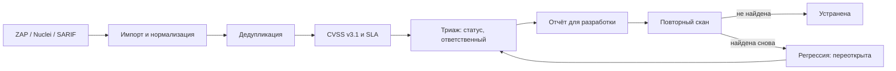

# vulntrack

Агрегатор находок сканеров безопасности. Собирает отчёты OWASP ZAP, Nuclei и SAST-инструментов (SARIF) в единый реестр уязвимостей, убирает дубли, считает CVSS v3.1 и сроки устранения по SLA, отслеживает исправления и регрессии и готовит отчёт для команд разработки.

Без внешних зависимостей: Python 3.10+ и стандартная библиотека (`sqlite3`, `argparse`, `json`).

## Зачем

В управлении уязвимостями сканеров несколько, и каждый пишет отчёт в своём формате. Одна и та же SQL-инъекция приходит и от ZAP, и от Nuclei; заголовки безопасности дают десятки однотипных строк; после фикса непонятно, закрыта ли проблема на самом деле. vulntrack закрывает весь цикл:



## Возможности

- **Парсеры:** OWASP ZAP (Traditional JSON), Nuclei (`-jsonl` и `-json-export`), SARIF 2.1.0 (Semgrep, Bandit, CodeQL, gosec). Формат определяется автоматически.
- **Нормализация эндпоинтов:** `/profile/1024/edit` и `/profile/2048/edit` → `/profile/{id}/edit`; query, fragment и порт по умолчанию отбрасываются, имена параметров сохраняются отдельно.
- **Дедупликация:** fingerprint = актив + тип слабости + эндпоинт. Конкретные CWE (89, 79, 22, 918 и др.) и CVE склеиваются между сканерами, и находка получает доказательства от обоих. Общие CWE (200, 693) не склеиваются, чтобы не потерять разные проблемы.
- **CVSS v3.1:** калькулятор базовой оценки по спецификации FIRST, сверен с эталонными векторами NVD.
- **SLA:** critical — 7 дней, high — 30, medium — 90, low — 180 (меняется в `vulntrack/sla.py`).
- **Жизненный цикл:** `open → in_progress → fixed | risk_accepted | false_positive`. Принятие риска и ложное срабатывание — только с обоснованием.
- **Повторное сканирование:** с `--close-missing` находки, которых нет в новом отчёте, закрываются. Если находка появляется снова, она переоткрывается как регрессия, и срок SLA считается заново.
- **Триаж аналитика:** CVSS, выставленный вручную, приоритетнее оценки сканера и не перезаписывается следующими импортами.
- **История:** у каждой находки журнал — кто нашёл, когда менялись статус, критичность и ответственный.
- **Отчёты и метрики:** HTML для команд, Markdown для тикета, CSV для Excel и импорта в Jira. Метрики: открытые по критичности, просрочки по SLA, MTTR (среднее время устранения).

Пример отчёта: [docs/sample-report.md](docs/sample-report.md) (HTML-версия — [docs/sample-report.html](docs/sample-report.html)).

## Безопасность самого инструмента

В отчётах сканеров лежат данные атакующего: payload'ы и куски ответов сервера. Поэтому:

- HTML-отчёт экранирует весь текст: `<script>alert(1)</script>` из evidence показывается как текст и не исполняется;
- ссылками становятся только `http`/`https`, поэтому `javascript:` из поля reference кликабельным не станет;
- ячейки CSV, начинающиеся с `= + - @`, экранируются от CSV-инъекции (выполнения формул в Excel);
- все SQL-запросы к базе параметризованы.

Каждый пункт покрыт тестом в [tests/test_report.py](tests/test_report.py).

## Быстрый старт

```bash
git clone https://github.com/<ваш-ник>/vulntrack.git
cd vulntrack
python -m vulntrack --help
```

Установка как команды: `pip install -e .`, после этого доступна `vulntrack --help`.

## Демо

В [samples/](samples/) лежат синтетические отчёты по учебному магазину `shop.example.test` (домен `.test` зарезервирован и не существует). Флаг `--today` фиксирует дату, чтобы демо давало одинаковый результат; в работе он не нужен.

```bash
# 1. Первое сканирование тремя инструментами
python -m vulntrack --today 2026-10-01 import samples/zap_report.json --asset demo-shop
python -m vulntrack --today 2026-10-01 import samples/nuclei_results.jsonl --asset demo-shop
python -m vulntrack --today 2026-10-01 import samples/semgrep.sarif --asset demo-shop

# 2. Триаж: оценили SQL-инъекцию, назначили команды, отметили ложное срабатывание
python -m vulntrack --today 2026-10-02 update 1 --cvss "CVSS:3.1/AV:N/AC:L/PR:N/UI:N/S:U/C:H/I:H/A:N" --owner team-catalog --status in_progress
python -m vulntrack --today 2026-10-02 update 2 --owner team-search
python -m vulntrack --today 2026-10-02 update 7 --status false_positive --comment "заголовок Server подменяет внешний балансировщик"

# 3. Повторный скан после фикса: SQL-инъекции и cookie без SameSite больше нет
python -m vulntrack --today 2026-10-12 import samples/zap_report_rescan.json --asset demo-shop --close-missing

# 4. Что просрочено, метрики и отчёт для разработчиков
python -m vulntrack --today 2026-11-04 list --overdue
python -m vulntrack --today 2026-11-04 stats
python -m vulntrack --today 2026-11-04 report --format html --out report.html
```

Что видно по ходу демо:

```text
nuclei_results.jsonl (nuclei): находок в отчёте 4
  новых: 3  уже известных: 0  связано с другими сканерами: 1
...
zap_report_rescan.json (zap): находок в отчёте 5
  новых: 0  уже известных: 5  связано с другими сканерами: 0
  переоткрыто: 0  дублей в отчёте: 0  закрыто как устранённые: 2

$ python -m vulntrack --today 2026-11-04 list --overdue
ID   Критичность  CVSS  Статус   Срок          Уязвимость                              Где
---  -----------  ----  -------  ------------  --------------------------------------  -------------------------------------
#2   Высокая      —     Открыта  2026-10-31 !  Cross Site Scripting (Reflected)        https://shop.example.test/search
#9   Высокая      7.5   Открыта  2026-10-31 !  Apache 2.4.49 - Path Traversal          https://shop.example.test/cgi-bin/...
#11  Высокая      —     Открыта  2026-10-31 !  SQL query built with string formatting  app/db.py:27
#13  Высокая      —     Открыта  2026-10-31 !  Hard-coded API key in source code       app/config.py:12

$ python -m vulntrack show 1
#1 SQL Injection
  Критичность:              Критическая
  CVSS:                     9.1 CVSS:3.1/AV:N/AC:L/PR:N/UI:N/S:U/C:H/I:H/A:N
  Статус:                   Устранена
  Сканеры:                  nuclei,zap
История:
  2026-10-01  created   обнаружена сканером zap
  2026-10-01  severity  Высокая → Критическая по данным nuclei
  2026-10-02  rescored  CVSS — → 9.1 (Критическая)
  2026-10-02  status    Открыта → В работе
  2026-10-12  status    В работе → Устранена: не обнаружена при повторном сканировании zap
```

## Команды

| Команда | Что делает |
| --- | --- |
| `import FILE [--asset A] [--close-missing]` | загрузить отчёт сканера |
| `list [--min-severity S] [--overdue] [--all]` | список находок, сначала самые критичные |
| `show ID` | карточка находки: доказательства, рекомендация, история |
| `update ID [--status] [--cvss] [--owner] [--comment]` | триаж |
| `report [--format html\|md\|csv] [--out FILE]` | отчёт для команд разработки |
| `stats` | сводка и MTTR |
| `cvss VECTOR` | посчитать CVSS v3.1 по вектору |

База по умолчанию — `vulntrack.db` в текущей папке, другой путь задаётся через `--db` или `VULNTRACK_DB`.

## Как устроено

```text
vulntrack/
  parsers/    zap.py, nuclei.py, sarif.py: каждый приводит отчёт к единой модели Finding
  models.py   модель находки, уровни критичности, статусы
  cvss.py     калькулятор CVSS v3.1
  sla.py      политика сроков устранения
  store.py    реестр в SQLite: дедупликация, статусы, SLA, история
  report.py   HTML / Markdown / CSV
  cli.py      командная строка
tests/        40 тестов: эталонные CVSS-векторы, парсеры, жизненный цикл, экранирование
samples/      синтетические отчёты для демо
```

Новый сканер — это новый модуль в `parsers/` с функцией `parse(data) -> ParseResult`.

## Тесты

```bash
python -m unittest discover -v
```

Тесты и демо прогоняются в GitHub Actions на Python 3.10, 3.12 и 3.13.

## Планы

- парсеры Trivy, Burp Suite XML и Nmap XML;
- приоритизация с учётом EPSS и каталога CISA KEV;
- выгрузка в Jira и DefectDojo через API;
- срок SLA с учётом критичности актива: интернет-периметр, персональные данные, платёжный контур.
